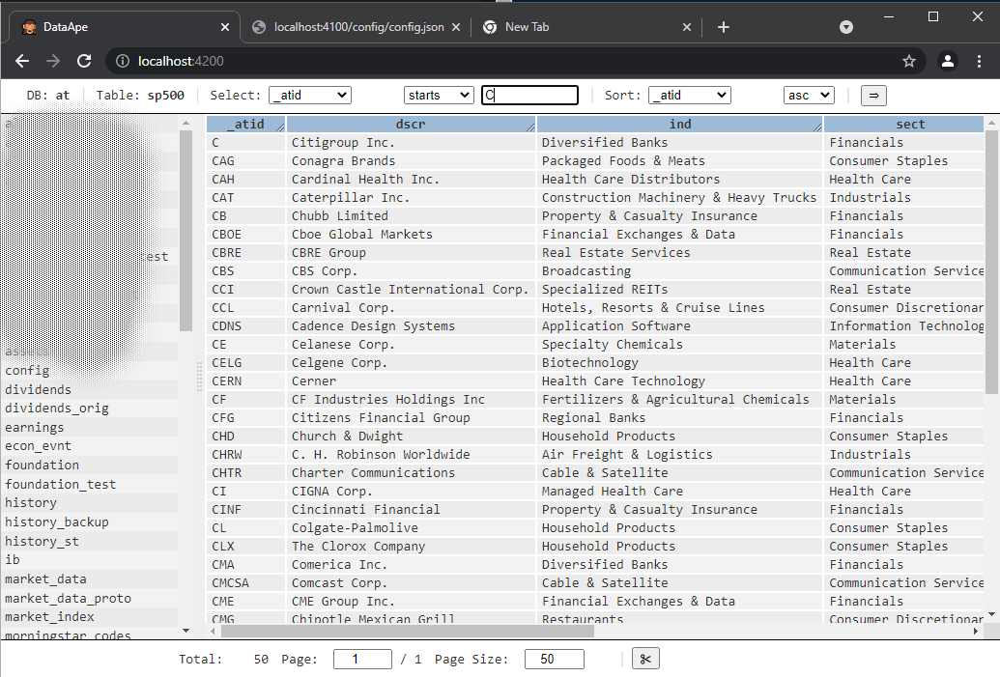

# data-ape
An optionally containerized database GUI for your browser.

### What's the point?
Existing tools didn't cut it for our use case of quickly reviewing database content for development and troubleshooting (i.e. processes that are either/or slow, clunky, expensive, annoy with licensing or use up too many resources on a Dev VM). So we spent a bit of time to write a web browser based tool and deploy it into an always-on Docker container. Now it even runs on the smartphone - as long as it's on the same network (we advise against running this tool on public/insecure environments!)

This tool is primarily targeting no-sql databases such as (and for now, only) MongoDB with support for filtering and sorting and primitive data types. It should be easy to extend to SQL databases, CSV files or wherever data is stored as long as it can be represented in tabular text. It's great for time series.

Unterlying code is Java for the server and TypeScript/Angular for the web GUI - since these technologies are currently being used in our main projects and skills are readily available. We tried to keep it simple with minimal dependencies (i.e. Angular, but not Angular Material, no Spring, etc). This project supports [VS Code Development Containers](https://code.visualstudio.com/docs/remote/containers).

Please note: This tool may expose your data due to improper configuration or bugs. Use at your own risk!

### Instructions

Data-Ape currently supports MongoDB. See the [frontend README](da-frontend-ng/README.md) for development and frontend tests and the [server README](da-server-ng/README.md) for configuration, backend tests, container builds, and deployment limitations. The legacy modules are available in Git history.

The backend requires JDK 25 or later; its dependencies resolve from Maven Central. The development container supplies JDK 25 and Node 16 (the newest Node line supported by Angular 13).

For the VS Code server launch configuration, create `.local/`, copy `da-server-ng/dev.properties.example` to `.local/server.properties`, and adjust the allowed MongoDB host. `.local/` is Git-ignored for machine-specific files; keep credentials out of tracked configuration. The frontend development server proxies API requests to the local backend.

The checked-in [Compose configuration](docker-compose.yml) describes the existing LAN deployment and its external configuration mount. It limits the server container to 1 GiB and configures a 768 MiB Java heap. It enables writes and non-atomic archive-first deletion; read the server README before using it. The application is not suitable for exposure to untrusted users.

Missing features can be added if there is interest and related submissions are welcome.

### Features:
   - Select, view and page through tabular data (database table, etc)
   - Query data with filters in GUI
   - Export query as MQL
   - Full-document JSON editing and archival deletion when writes are enabled; editing and deletion support string and ObjectId IDs
   - Dark and light themes, plus a settings dialog for disconnecting from the current database
   - Query through URL. Example:  
     http://&lt;host&gt;:&lt;port&gt;/?db=my_db&table=my_table&page=2&pageSize=40&sort=[{"key":"name","dir":"-1"}]&select=[{"key":"name","op":"stw","val":"A"}]&highlight=London
   - Sort data in GUI. Optionally define default sort per db/table in config file
   - Export result as CSV to Clipboard
   - Order columns with drag & drop. Optionally define default order per db/table in config file
   - Hide/View columns (right-click). Optionally define default hide/view columns per db/table in config file
   - Session persistence of select/sort/paging/highlight per table to conveniently switch between views
   - Highlight related cells on click (aid tracing in time-series etc)

### Roadmap:
   - Tabs (or a practical alternative) to keep several table views open (Session persistence of select/sort/paging/highlight lowers priority of tabs)
   - Check feasibility of conversion functions for table columns (example: eopch timestamp -> readable date)
   - Deal with non-primitive and nested data columns
   - Persist and GUI-edit configuration
   - Review security for multi-session, etc.

### Tips
   - To define order/hide/view columns, configure a server directory for database-specific configuration files, as described in the [server README](da-server-ng/README.md). Arrange the view in the GUI, then export to CSV and copy the headers into the config columns.
   - Clipboard access may require a secure browser context, such as HTTPS or localhost.

#### Thanks for looking!
